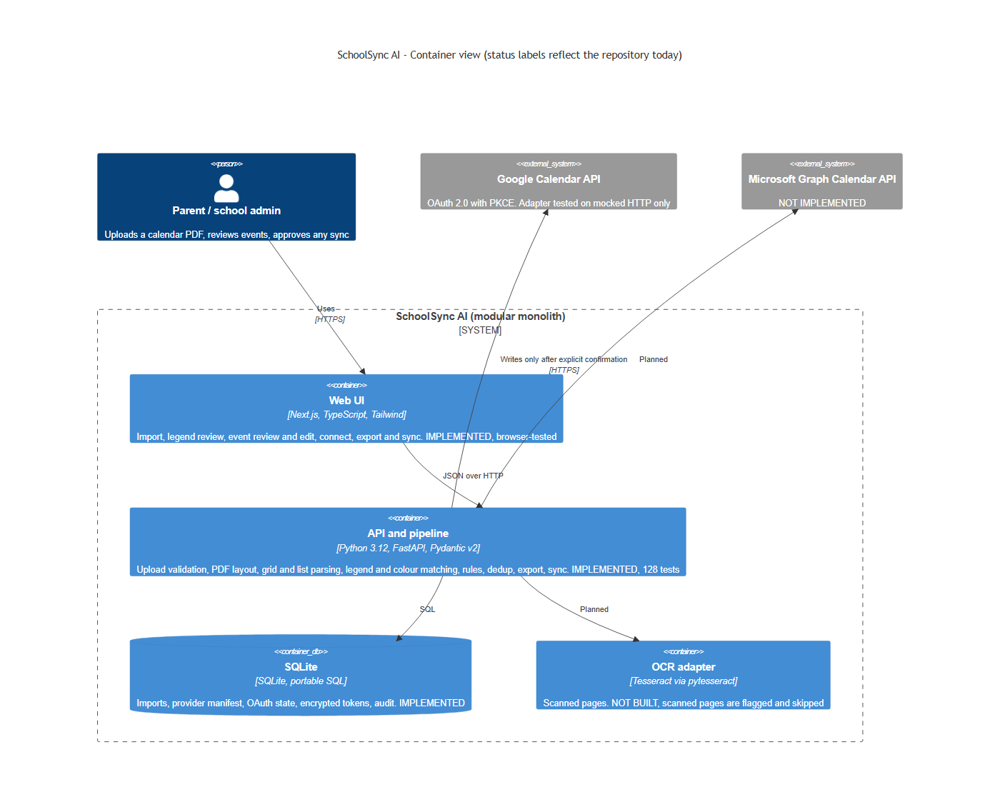
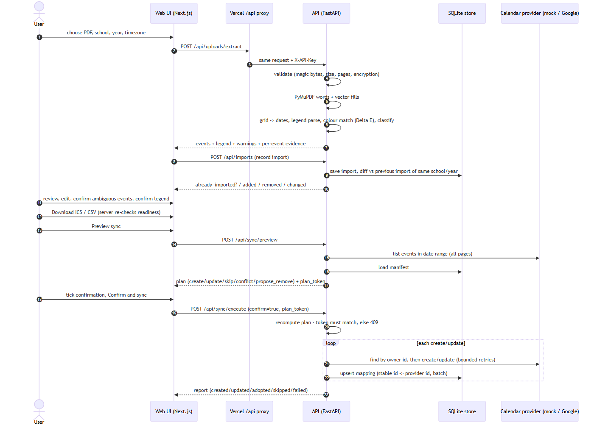
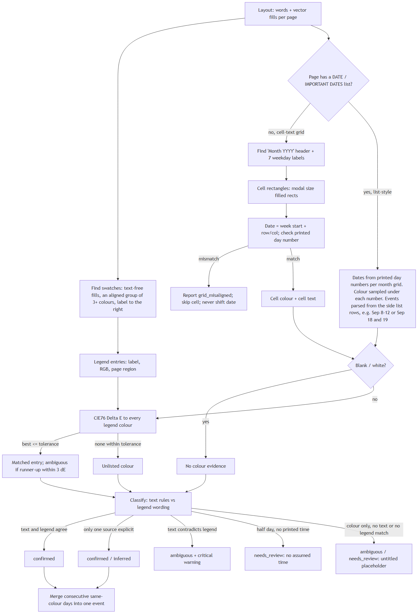
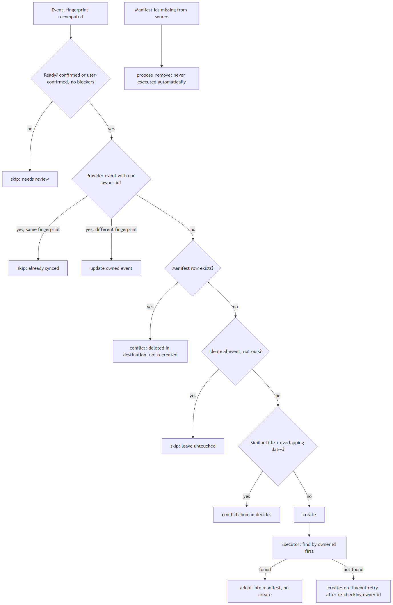
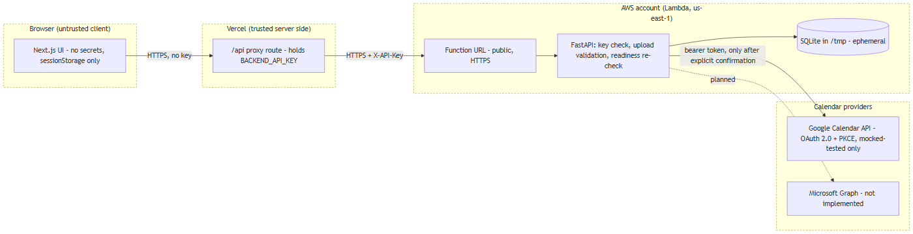

# Architecture

SchoolSync AI is a modular monolith. Package boundaries under `backend/app/` mirror the
pipeline stages. Status below reflects the repository today.

| Package | Responsibility | Status |
|---|---|---|
| `ingestion` | Untrusted-upload validation, SHA-256 | Implemented, tested |
| `pdf` | PyMuPDF words with coordinates and vector fills | Implemented, tested |
| `ocr` | OCR adapter | **Not implemented** (scanned pages are flagged and skipped) |
| `grid_detection` | Cell-text grids (`grid.py`) and list-style calendars with a side event list (`list_layout.py`); printed-day cross-checks | Implemented (vector PDFs only) |
| `legend`, `color_mapping` | Legend swatches, CIE76 Delta E matching | Implemented |
| `extraction`, `validation` | Events, half-day/all-day/timed rules, readiness | Implemented |
| `deduplication` | Fingerprint, stable id, layers A/B/C, import diff | Implemented |
| `imports` | SQLite store, manifest, executor, rollback | Implemented |
| `providers` | File export, mock, Google (mocked-tested), Microsoft (stub), OAuth | Partly implemented |
| `audit` | Audit rows in SQLite | Minimal (no dedicated package) |

Design rule: no LLM does date arithmetic, identity, duplicate verdicts, OAuth or sync
(ADR 0001); the shipped extractor uses no LLM.

## Diagrams
Each diagram is a Mermaid source file (`.mmd`, the source of truth) with a rendered PNG beside it.
All five were validated with the real Mermaid parser (v11.4.1, headless Chromium) and viewed.
GitHub does not render standalone `.mmd` files, so the PNGs are shown here.

**Container view** ([source](diagrams/c4-container.mmd))

**Upload to sync** ([source](diagrams/sequence-upload-to-sync.mmd))

**Grid, legend and colour decisions** ([source](diagrams/color-legend-flow.mmd))

**Duplicate-safe reconciliation** ([source](diagrams/reconciliation-flow.mmd))

**Trust boundaries** ([source](diagrams/trust-boundaries.mmd))

## ADRs
`docs/adr/0001` .. `0005` (validation vs LLM, schema/time semantics, duplicates and ownership,
provider abstraction, storage and cloud).
